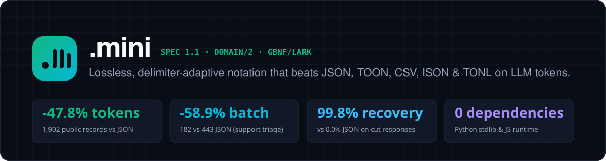
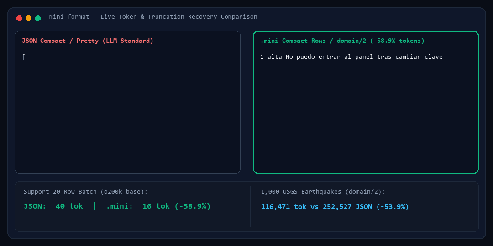
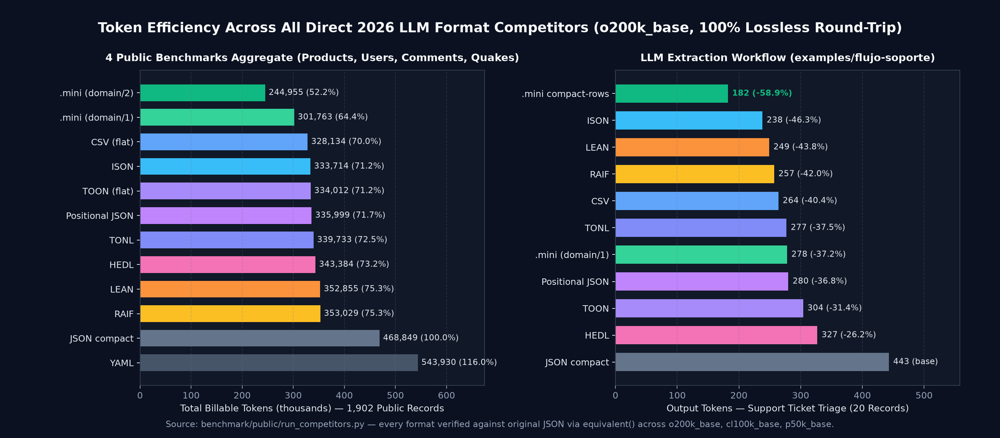
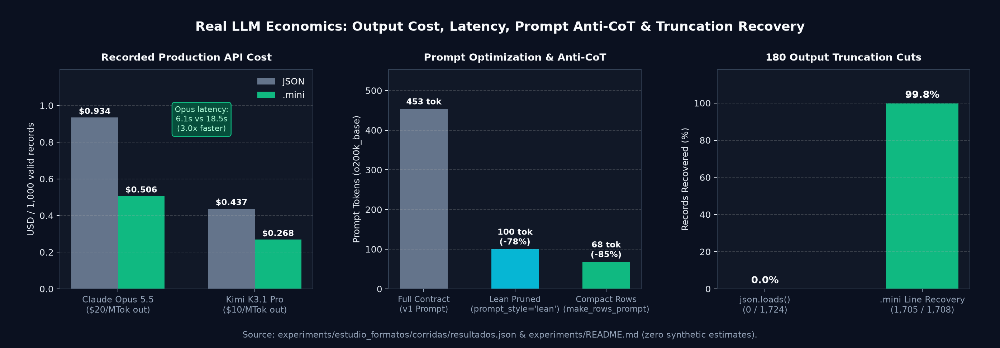
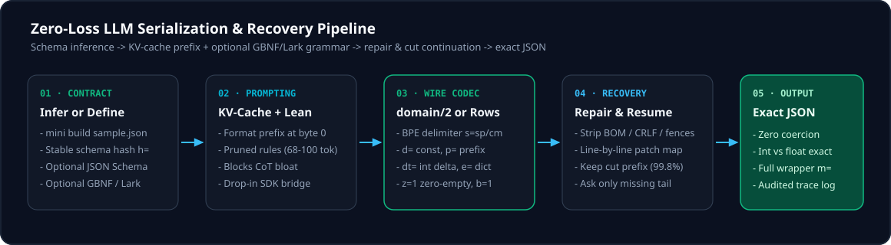

<div align="center">

<picture>
  <source media="(prefers-color-scheme: dark)" srcset="docs/assets/banner-dark.svg">
  <source media="(prefers-color-scheme: light)" srcset="docs/assets/banner-light.svg">
  
</picture>

<p>
  <a href="https://pypi.org/project/mini-format/"></a>
  <a href="https://www.python.org/"></a>
  <a href="LICENSE"></a>
  <a href="conformance/"></a>
  <a href="skills/mini-format/SKILL.md"></a>
</p>

<p>
  <strong>Reduce entre un 47,8 % y un 58,9 % la factura de tokens de salida frente a JSON y recupera el 99,8 % de los registros ante cortes por <code>max_tokens</code>.</strong><br>
  Ida y vuelta JSON exacta &middot; Comparativas reproducibles de tokens &middot; Cero dependencias en tiempo de ejecución
</p>

<p>
  <a href="#comparativa-2026-contra-competidores">Benchmarks</a> &middot;
  <a href="#costos-y-cortes-en-produccion">Economía LLM</a> &middot;
  <a href="#arquitectura-tecnica">Cómo funciona</a> &middot;
  <a href="#ejemplos-python-y-cli">Inicio rápido</a> &middot;
  <a href="#gramaticas-y-agent-skill">Gramáticas y Skill</a> &middot;
  <a href="https://mini-format.pmoluna.com">Playground</a> &middot;
  <a href="README.md">English</a>
</p>

</div>

---

<table>
  <tr>
    <td align="center" width="25%"><strong>244.955 vs 468.849</strong><br><sub>&minus;47,8 % tokens totales en 1.902 registros públicos frente a JSON compacto (<code>o200k_base</code>)</sub></td>
    <td align="center" width="25%"><strong>182 vs 443 tokens</strong><br><sub>&minus;58,9 % al serializar el ejemplo de 20 tickets</sub></td>
    <td align="center" width="25%"><strong>99,8 % recuperación</strong><br><sub>1.705 / 1.708 registros salvados tras corte vs 0 / 1.724 (0,0 %) con <code>json.loads()</code></sub></td>
    <td align="center" width="25%"><strong>&minus;45,9 % costo API real</strong><br><sub>Medido en Claude Opus 5.5 (\$0,506 vs \$0,934 / 1k registros) y latencia 3,0&times; menor</sub></td>
  </tr>
</table>

<p align="center">
  
</p>

## Por qué existe `.mini`

Cada vez que un LLM genera JSON (`{"id": 1, "categoria": "acceso", "prioridad": "alta", "titulo": "..."}`), pagas dinero y latencia por claves repetidas, comillas, dos puntos, llaves y fragmentación BPE de delimitadores como `|` o `,`. Además, si `max_tokens` corta la respuesta en el ticket 19, `json.loads()` falla entero y pierdes **los 20 registros**.

**`.mini`** resuelve todo el ciclo productivo de generación estructurada:

<table>
<tr>
<td width="50%" valign="top">

**JSON compacto estándar (`443 tokens`, 20 tickets)**
```json
[
  {"id":1,"categoria":"acceso","prioridad":"alta","titulo":"No puedo entrar al panel"},
  {"id":2,"categoria":"facturacion","prioridad":"media","titulo":"Factura duplicada"}
]
```
- Repite cada clave en todas las filas
- Falla de forma atómica ante truncamiento (`0 / 1.724`)

</td>
<td width="50%" valign="top">

**`.mini compact-rows` (`182 tokens`, &minus;58,9 %) / `domain/2`**
```text
1 alta acceso No puedo entrar al panel
2 media facturacion Factura duplicada
```
- Sin claves repetidas ni comillas en texto normal
- Valida línea por línea y recupera el `99,8 %` ante cortes
- Restaura **exactamente el mismo JSON** sin coerción

</td>
</tr>
</table>

---

## Comparativa 2026 contra competidores

[`benchmark/public/run_competitors.py`](benchmark/public/run_competitors.py) mide el texto serializado de **1.902 registros públicos** (`products`, `users`, `comments`, `earthquakes`) y un **ejemplo de 20 tickets** ([`examples/flujo-soporte`](examples/flujo-soporte)) con `o200k_base`, `cl100k_base` y `p50k_base`. El arnés verifica la ida y vuelta de los perfiles evaluados y aporta contexto de tipos y estructura a formatos como CSV, ISON, TONL y HEDL. Para medir el costo de generación también hay que contar las instrucciones, el contrato y los reintentos.

<p align="center">
  
</p>

### Tabla comparativa directa (`o200k_base`)

| Formato | Products (194) | Users (208) | Comments (500) | Earthquakes (1.000) | Total público (1.902) | Ahorro vs JSON | Soporte (20) |
|---|---:|---:|---:|---:|---:|---:|---:|
| **`.mini` (`domain/2` / `rows`)** | **60.431** | **38.751** | **29.302** | **116.471** | **244.955** | **&minus;47,8 %** | **182** (`mini_rows`, &minus;58,9 %) |
| `.mini` (`domain/1`) | 64.090 | 43.268 | 30.268 | 164.137 | 301.763 | &minus;35,6 % | 278 |
| CSV (plano reversible) | 67.057 | 60.028 | 29.869 | 171.180 | 328.134 | &minus;30,0 % | 264 |
| ISON v1.0 | 76.950 | 60.155 | 30.092 | 166.517 | 333.714 | &minus;28,8 % | 238 |
| TOON (plano, oficial 4.1.1) | 68.260 | 60.926 | 31.023 | 173.803 | 334.012 | &minus;28,8 % | 309 |
| JSON posicional (`[[...]]`) | 68.824 | 61.229 | 30.758 | 175.188 | 335.999 | &minus;28,3 % | 280 |
| TONL | 76.275 | 60.211 | 30.028 | 173.219 | 339.733 | &minus;27,5 % | 277 |
| HEDL | 76.666 | 60.619 | 31.029 | 175.070 | 343.384 | &minus;26,8 % | 327 |
| LEAN | 78.343 | 65.736 | 30.419 | 178.357 | 352.855 | &minus;24,7 % | 249 |
| RAIF | 78.384 | 65.808 | 30.436 | 178.401 | 353.029 | &minus;24,7 % | 257 |
| TOON (oficial tal cual) | 93.624 | 60.815 | 31.014 | 294.355 | 479.808 | +2,3 % | 304 |
| JSON compacto | 89.310 | 91.251 | 35.761 | 252.527 | 468.849 | 0,0 % | 443 |
| YAML | 100.014 | 104.827 | 39.719 | 299.370 | 543.930 | +16,0 % | 503 |
| JSON indentado | 119.823 | 131.181 | 45.260 | 353.250 | 649.514 | +38,5 % | 762 |

> **Reproducir en local**: `python benchmark/public/run_competitors.py` &mdash; tabla completa con `o200k_base`, `cl100k_base` y `p50k_base` en [`benchmark/public/competitors_table.md`](benchmark/public/competitors_table.md).

---

## Costos y cortes en produccion

Medir solo los tokens de salida oculta tres factores críticos en producción: **explosión de tokens de razonamiento (CoT)**, **pérdida ante cortes** y **peso del prompt**. Nuestro estudio empírico grabado ([`experiments/estudio_formatos/corridas/resultados.json`](experiments/estudio_formatos/corridas/resultados.json)) lo demuestra con datos reales:

<p align="center">
  
</p>

| Modelo y formato | Tokens salida (media) | Validez inicial | Validez final | Latencia media | USD / 1.000 registros válidos |
|---|---:|---:|---:|---:|---:|
| **Claude Opus 5.5** (`JSON`) | 934 | 100 % | 100 % | 18,5 s | \$0,934 |
| **Claude Opus 5.5** (`.mini`) | **506 (&minus;45,9 %)** | **100 %** | **100 %** | **6,1 s (3,0&times;)** | **\$0,506 (&minus;45,9 %)** |
| **Kimi K3.1 Pro** (`JSON`) | 875 | 100 % | 100 % | 18,5 s | \$0,437 |
| **Kimi K3.1 Pro** (`.mini`) | **537 (&minus;38,6 %)** | **100 %** | **100 %** | **14,2 s** | **\$0,268 (&minus;38,6 %)** |
| **Claude Haiku 5.5** (`JSON`) | 966 | 100 % | 100 % | 15,8 s | \$0,024 |
| **Claude Haiku 5.5** (`.mini v1` 11 reglas) | 1.330 *(+815 tok CoT)* | 66,7 % | 100 % | 7,6 s | \$0,042 *(prompt completo)* |

*En 180 cortes simulados sobre esas respuestas reales, `.mini` recuperó **1.705 / 1.708 (99,8 %)** registros completos y pidió únicamente los faltantes; `json.loads()` recuperó **0 / 1.724 (0,0 %)**.*

---

## Arquitectura tecnica

<p align="center">
  
</p>

`mini-domain/2` reduce tokens según el contenido y el tokenizador. El flujo puede reutilizar las instrucciones como prefijo de caché cuando el proveedor lo admite.

1. **Selección adaptativa de delimitador BPE (`s=sp|cm|tb`)**: En `o200k_base`, la barra `|` casi nunca se fusiona y consumía hasta el 22,1 % de tokens en v1. `domain/2` evalúa `" "`, `","`, `"\t"` y `"|"` por carga de trabajo: escoge espacio `" "` en texto tabular (las palabras absorben el espacio precedente a costo ~0 en BPE), respetando arreglos/objetos entre corchetes sin ambigüedad.
2. **Compresión estructural sin pérdida por columna**:
   - **`d=`**: Factoriza columnas constantes en `>= 2` filas fuera del cuerpo.
   - **`p=`**: Extrae prefijos comunes largos (`https://cdn.dummyjson.com/...`, fechas ISO) una sola vez en cabecera.
   - **`dt=`**: Codificación delta entera (`1789596033000 -> +45`), reduciendo `earthquakes` de **164.137 a 116.471 tokens (&minus;29,0 % frente a v1)**.
   - **`z=1` y `b=1`**: Celdas vacías de 0 tokens para opcionales/nulls ausentes y booleanos `1`/`0`.
   - **`e=`**: Diccionarios por documento sobre cadenas repetidas y objetos/listas frecuentes.
   - **`tl=`**: Coloca al final la columna con frases libres para evitar comillas o escapes.
3. **Prompts ligeros anti-CoT (`prompt_style="lean"`)**: Descubrimos en los registros de Haiku 5.5 que enviar las 11 reglas + esquema JSON completo (`453–571` tok) provocaba 815 tokens de razonamiento. `make_lean_prompt()` poda reglas inaplicables bajando a **100 tokens (&minus;78 %)**, y `make_rows_prompt()` a **68 tokens (&minus;85 %)**.
4. **Prefijo KV-Cache en byte 0 (`kv_cache_first=True`)**: `Workflow(..., kv_cache_first=True)` coloca las instrucciones estáticas al principio de `messages`, maximizando lecturas cacheadas en Anthropic y OpenAI.
5. **Compilador de gramáticas (`mini grammar`)**. Genera gramáticas **GBNF**, **Lark** o **Regex** para restringir la sintaxis en proveedores y entornos compatibles.

---

## Instalación y ejemplos

```bash
python -m pip install mini-format --index-url https://mini-format.pmoluna.com/simple/
# Opcional: tiktoken y utilidades de benchmark
python -m pip install "mini-format[bench] @ https://mini-format.pmoluna.com/downloads/mini_format-1.3.4-py3-none-any.whl"
```

Para la biblioteca base de Node.js, descarga `mini-format-core-1.3.4.tgz` desde [Descargas](https://mini-format.pmoluna.com/downloads/) e instala el archivo.

```bash
npm install ./mini-format-core-1.3.4.tgz
```

```bash
mini setup                                         # Asistente interactivo paso a paso
mini build muestra.json --prefix ticket --out .mini
mini grammar .mini/contract.json --format gbnf
mini integrate app.py --bundle .mini --apply
```

```python
from minifmt.domain import decode, encode_v2, infer_contract
from minifmt.workflow import Workflow

contract = infer_contract([records], prefix="events")
wire = encode_v2(records, contract)
assert decode(wire, contract) == records

# Flujo productivo con prompt ligero anti-CoT, KV-cache y recuperación ante cortes
flow = Workflow(".mini", lang="es", prompt_style="lean", kv_cache_first=True)
data = flow.run(mi_modelo, "Clasifica los 20 tickets", expected_records=20)
# O filas ultracompactas (182 tok vs 443 JSON):
tickets = flow.run_compact(mi_modelo, "Clasifica 20 tickets", last_text_field="titulo", expected_records=20)
```

---

## Gramaticas y Agent Skill

- Compila cualquier contrato a **GBNF**, **Lark** o **Regex** mediante `minifmt.contract_to_gbnf`, `contract_to_lark`, `contract_to_regex` o el comando `mini grammar`.
- Hemos incluido un **Agent Skill** listo para agentes en [`skills/mini-format/SKILL.md`](skills/mini-format/SKILL.md).

## Límites honestos y cuándo NO usarlo

- **Objetos únicos pequeños (`n=1`)**: la cabecera `prefix|v=1|...` pesa más que ahorrar algunas claves; usa JSON normal o `compact_rows`.
- **Modelos pequeños/razonadores sin `prompt_style="lean"`**: como demostró Haiku 5.5, demasiadas reglas sintácticas pueden disparar CoT; mide siempre entrada + razonamiento + salida.

<details>
<summary><strong>Conformidad, verificación e infraestructura del sitio</strong></summary>

- **376 casos en 14 familias**: suite cruzada en Python, JS navegador (`js/mini.js`) y oráculo TS (`ts/`).
- **Integridad auditada**: `python tools/evidencia.py verificar`.
- **Web y Playground**: tablas reproducibles, calculadora económica y playground interactivo en [`sitio/`](sitio/) y [`playground/`](playground/).

</details>
