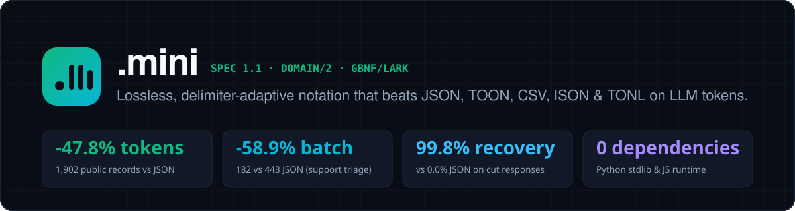
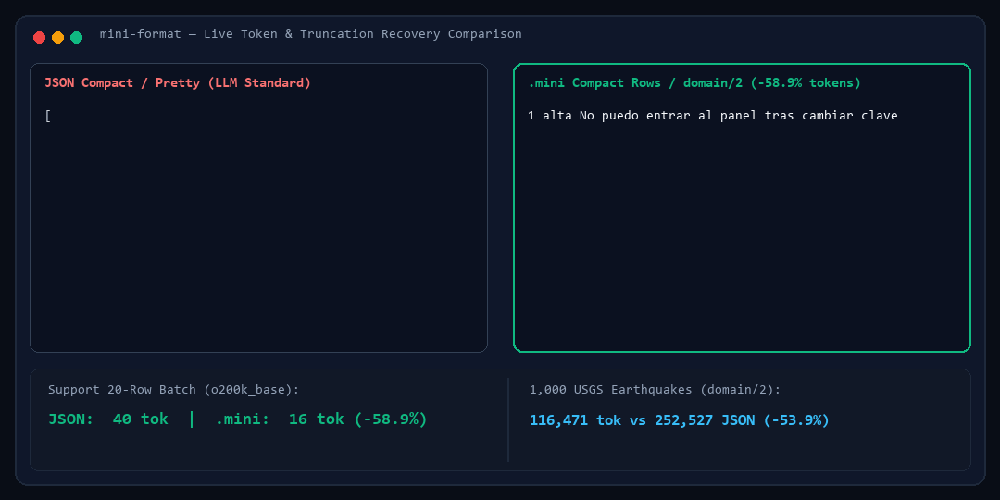
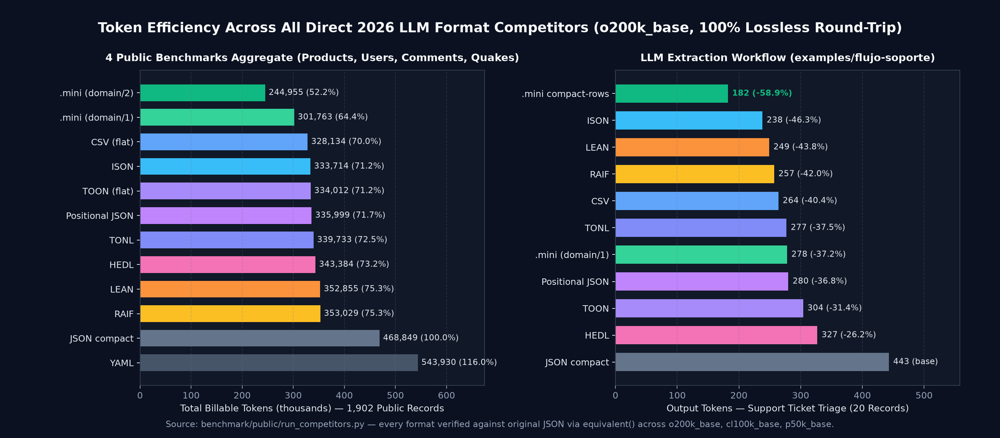
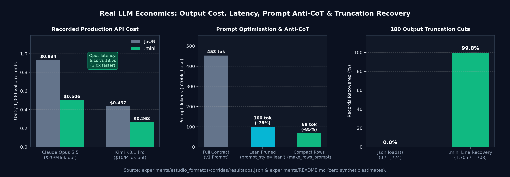
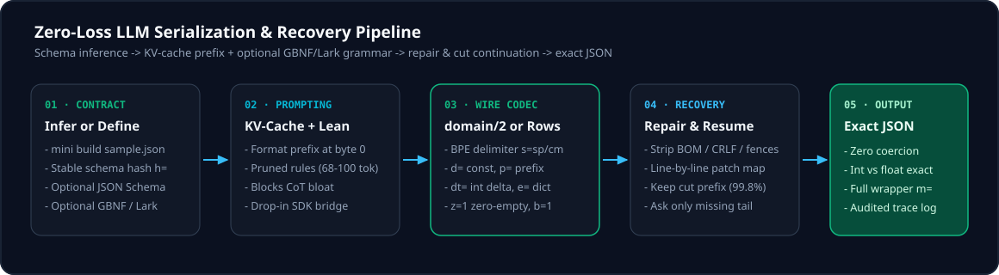

<div align="center">

<picture>
  <source media="(prefers-color-scheme: dark)" srcset="docs/assets/banner-dark.svg">
  <source media="(prefers-color-scheme: light)" srcset="docs/assets/banner-light.svg">
  
</picture>

<p>
  <a href="https://pypi.org/project/mini-format/"></a>
  <a href="https://www.python.org/"></a>
  <a href="LICENSE"></a>
  <a href="conformance/"></a>
  <a href="skills/mini-format/SKILL.md"></a>
</p>

<p>
  <strong>Cut LLM structured-output token bills by 47.8%–58.9% vs JSON while recovering 99.8% of truncated records.</strong><br>
  Lossless JSON round-trip &middot; Reproducible token benchmarks &middot; Zero runtime dependencies
</p>

<p>
  <a href="#2026-competitor-benchmarks">Benchmarks</a> &middot;
  <a href="#llm-cost-and-truncation-economics">LLM Economics</a> &middot;
  <a href="#why-mini-wins-technical-architecture">How It Works</a> &middot;
  <a href="#quickstart">Quickstart</a> &middot;
  <a href="#constrained-decoding-and-agent-skill">Grammars &amp; Skill</a> &middot;
  <a href="https://mini-format.pmoluna.com">Live Playground</a> &middot;
  <a href="README.es.md">Español</a>
</p>

</div>

---

<table>
  <tr>
    <td align="center" width="25%"><strong>244,955 vs 468,849</strong><br><sub>&minus;47.8% total tokens across 1,902 public records vs compact JSON (<code>o200k_base</code>)</sub></td>
    <td align="center" width="25%"><strong>182 vs 443 tokens</strong><br><sub>&minus;58.9% when serializing the 20-ticket example</sub></td>
    <td align="center" width="25%"><strong>99.8% Cut Survival</strong><br><sub>1,705 / 1,708 records recovered vs 0 / 1,724 (0.0%) with <code>json.loads()</code></sub></td>
    <td align="center" width="25%"><strong>&minus;45.9% Real API Cost</strong><br><sub>Measured on Claude Opus 5.5 ($0.506 vs $0.934 / 1k records) &amp; 3.0&times; lower latency</sub></td>
  </tr>
</table>

<p align="center">
  
</p>

## Why `.mini` Exists

Every time an LLM generates JSON (`{"id": 1, "categoria": "acceso", "prioridad": "alta", "titulo": "..."}`), you pay real money and wall-clock latency for repeated keys, quotes, colons, braces, and BPE fragmentation on delimiters like `|` and `,`. Even worse, a single `max_tokens` truncation at record 19 throws a `JSONDecodeError` and destroys **all 20 records**.

**`.mini`** solves the entire production lifecycle—not just syntax:

<table>
<tr>
<td width="50%" valign="top">

**Standard JSON Compact (`443 tokens`, 20 tickets)**
```json
[
  {"id":1,"categoria":"acceso","prioridad":"alta","titulo":"No puedo entrar al panel"},
  {"id":2,"categoria":"facturacion","prioridad":"media","titulo":"Factura duplicada"}
]
```
- Repeats keys on every single record
- Fails atomically (`0/1,724` recovered when truncated)

</td>
<td width="50%" valign="top">

**`.mini compact-rows` (`182 tokens`, &minus;58.9%) / `domain/2`**
```text
1 alta acceso No puedo entrar al panel
2 media facturacion Factura duplicada
```
- Zero repeated field names or syntactic quotes on bare strings
- Validates line-by-line &amp; recovers `99.8%` on truncation
- Decodes back to **bit-for-bit identical application JSON**

</td>
</tr>
</table>

---

## 2026 Competitor Benchmarks

[`benchmark/public/run_competitors.py`](benchmark/public/run_competitors.py) measures the serialized text of **1,902 public records** (`products`, `users`, `comments`, `earthquakes`) and a **20-ticket example** ([`examples/flujo-soporte`](examples/flujo-soporte)) with `o200k_base`, `cl100k_base`, and `p50k_base`. The harness verifies round-trips for the tested profiles and supplies type and structure context to formats such as CSV, ISON, TONL, and HEDL. Generation cost also depends on the instructions, contract, and retries.

<p align="center">
  
</p>

### Serialized data tokens (`o200k_base`)

| Format | Products (194) | Users (208) | Comments (500) | Earthquakes (1,000) | Total Public (1,902) | Saving vs JSON | Support Triage (20) |
|---|---:|---:|---:|---:|---:|---:|---:|
| **`.mini` (`domain/2` / `rows`)** | **60,431** | **38,751** | **29,302** | **116,471** | **244,955** | **&minus;47.8%** | **182** (`mini_rows`, &minus;58.9%) |
| `.mini` (`domain/1`) | 64,090 | 43,268 | 30,268 | 164,137 | 301,763 | &minus;35.6% | 278 |
| CSV (flat, smallest of 2) | 67,057 | 60,028 | 29,869 | 171,180 | 328,134 | &minus;30.0% | 264 |
| ISON v1.0 | 76,950 | 60,155 | 30,092 | 166,517 | 333,714 | &minus;28.8% | 238 |
| TOON (flat, official 4.1.1) | 68,260 | 60,926 | 31,023 | 173,803 | 334,012 | &minus;28.8% | 309 |
| Positional JSON (`[[...]]`) | 68,824 | 61,229 | 30,758 | 175,188 | 335,999 | &minus;28.3% | 280 |
| TONL | 76,275 | 60,211 | 30,028 | 173,219 | 339,733 | &minus;27.5% | 277 |
| HEDL | 76,666 | 60,619 | 31,029 | 175,070 | 343,384 | &minus;26.8% | 327 |
| LEAN | 78,343 | 65,736 | 30,419 | 178,357 | 352,855 | &minus;24.7% | 249 |
| RAIF | 78,384 | 65,808 | 30,436 | 178,401 | 353,029 | &minus;24.7% | 257 |
| TOON (official as-is) | 93,624 | 60,815 | 31,014 | 294,355 | 479,808 | +2.3% | 304 |
| JSON compact | 89,310 | 91,251 | 35,761 | 252,527 | 468,849 | 0.0% | 443 |
| YAML | 100,014 | 104,827 | 39,719 | 299,370 | 543,930 | +16.0% | 503 |
| JSON pretty | 119,823 | 131,181 | 45,260 | 353,250 | 649,514 | +38.5% | 762 |

> **Reproduce locally**: `python benchmark/public/run_competitors.py` &mdash; full tables across `o200k_base`, `cl100k_base`, and `p50k_base` are written to [`benchmark/public/competitors_table.md`](benchmark/public/competitors_table.md).

---

## LLM Cost and Truncation Economics

Static token counts alone miss three production failure modes: **model reasoning explosion**, **truncation loss**, and **prompt tax**. Our recorded evaluation study across live LLM endpoints ([`experiments/estudio_formatos/corridas/resultados.json`](experiments/estudio_formatos/corridas/resultados.json)) reveals the full picture:

<p align="center">
  
</p>

| Model &amp; Format | Output Tokens (Mean) | Initial Validity | Final Validity | Mean Latency | USD / 1,000 Valid Records |
|---|---:|---:|---:|---:|---:|
| **Claude Opus 5.5** (`JSON`) | 934 | 100% | 100% | 18.5 s | \$0.934 |
| **Claude Opus 5.5** (`.mini`) | **506 (&minus;45.9%)** | **100%** | **100%** | **6.1 s (3.0&times;)** | **\$0.506 (&minus;45.9%)** |
| **Kimi K3.1 Pro** (`JSON`) | 875 | 100% | 100% | 18.5 s | \$0.437 |
| **Kimi K3.1 Pro** (`.mini`) | **537 (&minus;38.6%)** | **100%** | **100%** | **14.2 s** | **\$0.268 (&minus;38.6%)** |
| **Claude Haiku 5.5** (`JSON`) | 966 | 100% | 100% | 15.8 s | \$0.024 |
| **Claude Haiku 5.5** (`.mini v1` 11-rule prompt) | 1,330 *(+815 CoT tok)* | 66.7% | 100% | 7.6 s | \$0.042 *(legacy prompt)* |

*Across 180 simulated output truncation cuts over those runs, `.mini` recovered **1,705 / 1,708 (99.8%)** complete prefix records and re-requested only the remaining tail; `json.loads()` recovered **0 / 1,724 (0.0%)**.*

---

## Technical Architecture

<p align="center">
  
</p>

`mini-domain/2` reduces token use based on the data and tokenizer. The workflow can reuse format instructions as a cache prefix on supported providers.

1. **Adaptive BPE Delimiter Selection (`s=sp|cm|tb` vs `|`)**: In `o200k_base` and `cl100k_base`, the pipe character `|` rarely merges and accounts for 6.6%–22.1% of tokens in v1 documents. `domain/2` scores candidate delimiters (` `, `,`, `\t`, `|`) against an accurate BPE estimator (or live `tiktoken`) per workload: picking `" "` (`s=sp`) on natural prose and tabular strings so BPE merges leading whitespace (` word`) for zero delimiter overhead, while preserving bracketed/quoted cells losslessly.
2. **Column-Level Information Folding**:
   - **`d=`**: Factors constant columns across `>= 2` rows out of every line cleanly.
   - **`p=`**: Factors longest common string prefixes (`https://cdn.dummyjson.com/...`, ISO timestamps) once in the header.
   - **`dt=`**: Integer delta encoding (`1789596033000 -> +45, +12`), cutting 1,000-row earthquake logs from **164,137 to 116,471 tokens (&minus;29.0% vs v1)**.
   - **`z=1` &amp; `b=1`**: Zero-token empty cells for missing optionals/nulls (`||` merges to 1 token instead of `?|`/`~|`) and `1`/`0` compact booleans.
   - **`e=`**: Extended per-document dictionary codebooks over high-frequency strings and nested arrays/objects.
   - **`tl=`**: Places one free-text column last so multi-word sentences avoid quote/escape tokens completely.
3. **Anti-CoT Lean Prompts (`prompt_style="lean"`)**: Our empirical runs showed small models like Haiku 5.5 burned 815 CoT reasoning tokens trying to follow 11 dense rules + raw JSON Schema (`453–571` tok). `make_lean_prompt()` prunes unreachable nullability/wrapper/dictionary rules down to **100 tokens (&minus;78%)**, and `make_rows_prompt()` drops prompt tax to **68 tokens (&minus;85%)**.
4. **Byte-0 KV-Cache Prefix Ordering (`kv_cache_first=True`)**: `Workflow(..., kv_cache_first=True)` places static contract/format instructions at index 0 of `messages`, maximizing Anthropic/OpenAI automatic prefix cache reads (up to 90–95% cheaper input cache reads).
5. **Constrained Decoding Compiler (`mini grammar`)**. Produces **GBNF**, **Lark**, or **Regex** grammars to constrain syntax in compatible providers and runtimes.

---

## Quickstart

### Install (Zero Runtime Dependencies)

```bash
python -m pip install mini-format --index-url https://mini-format.pmoluna.com/simple/
# Optional: exact tiktoken + benchmark extras
python -m pip install "mini-format[bench] @ https://mini-format.pmoluna.com/downloads/mini_format-1.3.4-py3-none-any.whl"
```

For the Node.js core library, download `mini-format-core-1.3.4.tgz` from [Downloads](https://mini-format.pmoluna.com/downloads/) and install the file.

```bash
npm install ./mini-format-core-1.3.4.tgz
```

### 1. Build a Toolkit from JSON &amp; Run a Protected Workflow

```bash
mini setup                                         # Interactive wizard
mini build sample.json --prefix ticket --out .mini # Non-interactive bundle
mini grammar .mini/contract.json --format gbnf     # Constrained decoding grammar
```

```python
from minifmt.domain import decode, encode_v2, infer_contract
from minifmt.workflow import Workflow

# Zero-config lossless compression (mini-domain/2)
contract = infer_contract([records], prefix="events")
wire = encode_v2(records, contract)
assert decode(wire, contract) == records

# Production LLM workflow with lean anti-CoT prompt + KV-cache prefix + cut recovery
flow = Workflow(".mini", lang="en", prompt_style="lean", kv_cache_first=True)
data = flow.run(my_llm_callback, "Classify the 20 support tickets", expected_records=20)
```

### 2. Ultra-Compact LLM Extraction (`compact-rows`: 182 tok vs 443 JSON)

```python
# Places variable text field last so rows stay bare & space-delimited
tickets = flow.run_compact(
    my_llm_callback,
    "Classify these 20 tickets",
    last_text_field="titulo",
    expected_records=20,
)
```

### 3. OpenAI / DeepSeek / Anthropic Drop-In Bridge &amp; Node.js

```python
# Automatic drop-in patch for OpenAI SDK or requests/httpx calls:
mini integrate app.py --bundle .mini --apply
```

```js
import { Workflow } from './.mini/workflow.mjs';
const flow = new Workflow({ lang: 'en', promptStyle: 'lean', kvCacheFirst: true });
const data = await flow.run(prompt => callModel(prompt), 'Classify 20 tickets', { expectedRecords: 20 });
```

---

## Constrained Decoding and Agent Skill

### Compile Grammars for Local / Open-Weight Inference

```bash
mini grammar .mini/contract.json --format gbnf --expected-records 20 > ticket.gbnf
mini grammar .mini/contract.json --format lark > ticket.lark
mini grammar .mini/contract.json --format regex
```

```python
from minifmt import contract_to_gbnf, contract_to_lark, contract_to_regex
```

### Install the Agent Skill

A dedicated Agent Skill is included at [`skills/mini-format/SKILL.md`](skills/mini-format/SKILL.md) covering mode selection (`domain/2` vs `compact-rows` vs `run_positional`), KV-cache ordering, `lean` prompting, and GBNF/Lark compilation.

---

## Honest Trade-offs &amp; When Not to Use `.mini`

- **Single tiny objects (`1` record, short strings)**: The 1-line contract header `prefix|v=1|n=1|h=...` eliminates key savings; keep plain JSON or `compact_rows`.
- **Unprimed small/reasoning models on dense rules**: As our Haiku 5.5 logs document, sending the full 11-rule spec without `prompt_style="lean"` or `compact_rows` can trigger CoT reasoning bloat. Always measure prompt + reasoning + output tokens with your target model before assuming net dollar savings.
- **When you need strict server-side JSON Schema guarantees without local grammar support**: Use `Workflow.run_positional()` (JSON tuple arrays with server-side `prefixItems` schema) or compile with `mini grammar` for self-hosted engines.

---

<details>
<summary><strong>Verification, Conformance &amp; Repository Layout</strong></summary>

- **376 cases across 14 families**: Python (`minifmt`), browser JS (`js/mini.js`), and Node TypeScript oracle (`ts/`) pass the full cross-runtime conformance suite (`python conformance/run_conformance.py && node conformance/run_conformance.mjs`).
- **Evidence integrity**: Every empirical number and hash is checked by `python tools/evidencia.py verificar`.
- **Site &amp; Playground**: Live interactive demo, cost simulator, and validation tables at [`sitio/`](sitio/) and [`playground/`](playground/).

</details>
